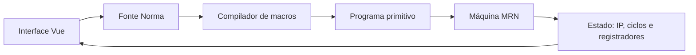
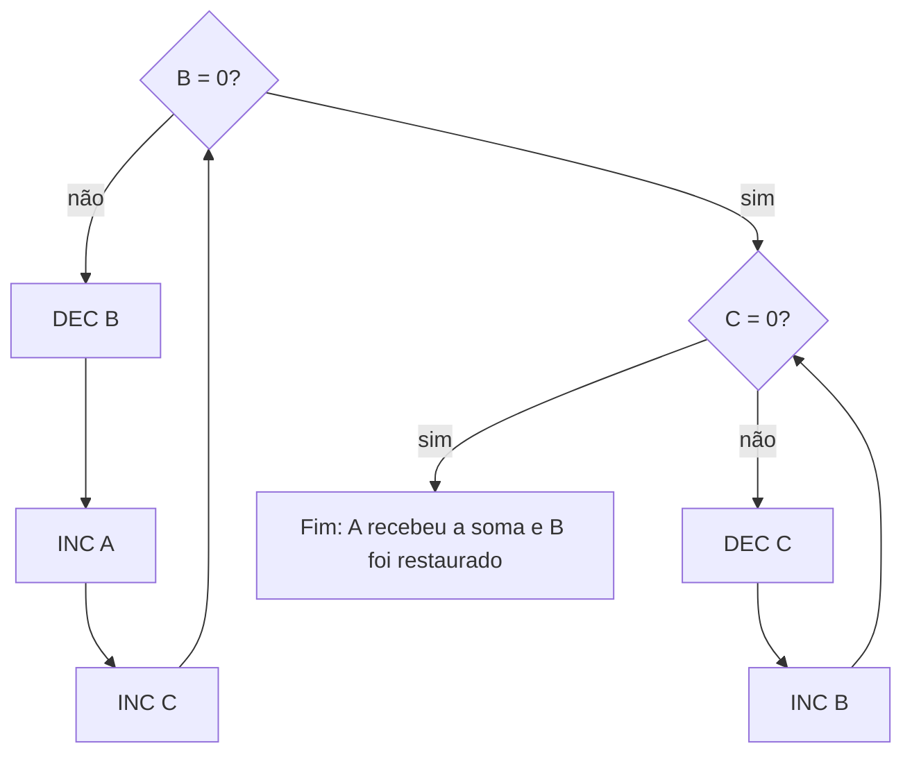
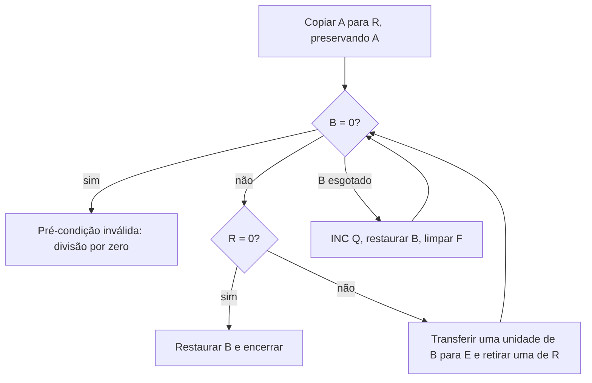

# Relatório técnico de engenharia - Norma Lab

> Complete antes da entrega: integrantes, RAs, turma e data.

**Disciplina:** Análise de Computabilidade e Complexidade de Algoritmos  
**Professor:** Cláudio Filgueira  
**Integrantes / RA:** ______________________________________________

## 1. Objetivo

O Norma Lab interpreta programas da Máquina de Registradores Norma e oferece uma camada de compilação para rotinas usuais. A aplicação foi pensada para tornar observável o efeito de cada instrução: o ponteiro de instrução, os registradores ativos e o histórico permanecem visíveis durante a execução.

## 2. Arquitetura

O compilador converte cada macro em uma sequência formada exclusivamente por `INC`, `DEC` e `TST`. O interpretador não executa uma macro diretamente. Assim, a tela de depuração mostra o mesmo tipo de instrução que existe no modelo formal.

## 3. Modelo do interpretador

Cada programa compilado possui uma lista sequencial de instruções e uma tabela que associa rótulos ao índice da instrução correspondente. A memória é um mapa de registradores para valores `bigint`; por isso, o tamanho de um valor não fica limitado ao tipo numérico convencional do JavaScript.

| Instrução | Regra de transição |
|---|---|
| `INC R` | `R := R + 1`; avança IP |
| `DEC R` | se `R > 0`, `R := R - 1`; avança IP |
| `TST R Z N` | IP recebe o rótulo `Z` quando `R = 0`; caso contrário, recebe `N` |

O decremento protegido mantém `R = 0` quando uma instrução `DEC R` é aplicada em zero. Esse comportamento implementa a restrição do domínio dos naturais.

## 4. Mapeamento de registradores

| Registro | Papel nos exemplos |
|---|---|
| A, B | Operandos de entrada |
| C | Acumulador do produto e auxiliar da soma preservativa |
| Q | Quociente na divisão inteira |
| R | Resto na divisão inteira |
| D, E, F | Temporários internos usados pelas expansões de multiplicação e divisão |

Os temporários são mostrados na interface quando participam da execução. Para programas criados pelo grupo, recomenda-se reservar `D`, `E` e `F` às macros para evitar colisões com dados de entrada.

## 5. Fluxo da soma preservativa

O registro `C` contabiliza quantas unidades foram transferidas de `B` para `A`. No segundo laço, cada unidade de `C` volta para `B`. Por isso, a macro satisfaz a condição de preservação de `B`.

## 6. Fluxo da divisão e do resto

O algoritmo usa subtrações sucessivas. A cada subtração integral de `B` em `R`, incrementa `Q`; quando a próxima subtração não pode ser completada, `R` contém o resto. A divisão por zero deve ser impedida na demonstração por uma pré-condição `B > 0`.

## 7. Resultados da bateria obrigatória

| Caso | Entrada | Resultado esperado | Resultado observado |
|---|---|---|---|
| TC-01 | `A=5, B=3, C=0` | `A=8, B=3, C=0` | preencher após execução |
| TC-02 | `A=3, B=5` | `A=0` | preencher após execução |
| TC-03 | `A=4, B=3, C=0` | `A=4, B=3, C=12` | preencher após execução |
| TC-04 | `A=14, B=3` | `Q=4, R=2` | preencher após execução |

## 8. Procedimento de demonstração

Primeiro, execute TC-01 em modo passo a passo e destaque a restauração de `B`. Em seguida, execute TC-02 para mostrar a saturação em zero. TC-03 e TC-04 podem ser executados continuamente, mantendo o histórico aberto. Por fim, reduza o limite de ciclos e use um laço intencional para demonstrar a trava de segurança.
